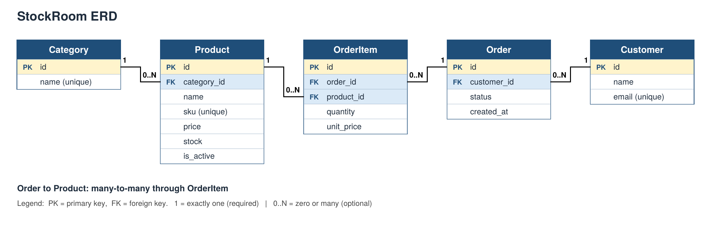

# StockRoom - Catalogue and Order Data System

Unit 5 project: a small Django data layer for working with models, migrations, CRUD, QuerySets, relationships, annotation and aggregation.

The project is mainly worked through the Django shell and `inventory/queries.py`. No user interface was built.

---

## 1. Setup

To run the project:

```bash
git clone https://github.com/khdiu22/Khdijah-Unit-5.git
cd Khdijah-Unit-5
python -m venv venv
venv\Scripts\activate
pip install django
cd stockroom_project
python manage.py migrate
python manage.py shell
```

The project uses SQLite, which is the default database. Running `migrate` creates `db.sqlite3`.

The models are also registered in `inventory/admin.py`. To check the data through Django admin:

```bash
python manage.py createsuperuser
python manage.py runserver
```

Then open `/admin/`.

The sample data can be added by running the commands in section 5 inside the Django shell.

## 2. Project structure

```text
Khdijah-Unit-5/
├── README.md
├── evidence/
│   ├── erd.pdf
│   ├── erd.png
│   └── (screenshots of the shell results used in this README)
└── stockroom_project/
    ├── manage.py
    ├── stockroom_project/
    │   ├── settings.py
    │   └── urls.py
    └── inventory/
        ├── admin.py
        ├── models.py
        ├── queries.py
        └── migrations/
            ├── 0001_initial.py
            └── 0002_product_is_active.py
```

`inventory` is added to `INSTALLED_APPS` in `settings.py`.

## 3. ERD

The ERD file is available here:

[evidence/erd.pdf](evidence/erd.pdf)



The diagram shows the primary keys, foreign keys, cardinality and optionality.

`1` means exactly one and required, while `0..N` means zero or many.

The relationships are:

- Category to Product: one-to-many
- Customer to Order: one-to-many
- Order to OrderItem: one-to-many
- Product to OrderItem: one-to-many
- Order to Product: many-to-many through `OrderItem`

## 4. Models, relationships and constraints

| Model | Fields |
|---|---|
| Category | name (unique) |
| Product | name, sku (unique), price, stock, is_active, category |
| Customer | name, email (unique) |
| Order | customer, status (pending / paid / shipped), created_at |
| OrderItem | order, product, quantity, unit_price |

Every model has a `__str__` method.

The default ordering in `class Meta` is:

- Category and Customer by name
- Product by name
- Order by newest first

### Relationships and on_delete

| Foreign key | on_delete | Why |
|---|---|---|
| Product.category | PROTECT | A category that still has products cannot be deleted by mistake. |
| Order.customer | PROTECT | A customer who has orders cannot be deleted, so order history is kept. |
| OrderItem.order | CASCADE | An order item has no meaning without its order, so it is removed with it. |
| OrderItem.product | PROTECT | A product that appears in orders cannot be deleted, so past orders stay valid. |

`Order.products` uses a `ManyToManyField` with `through='OrderItem'`.

### Database constraints

| Rule | Constraint |
|---|---|
| Product.sku unique | `unique=True` |
| Customer.email unique | `unique=True` |
| Category.name unique | `unique=True` |
| Product.price >= 0 | CheckConstraint `product_price_gte_0` |
| Product.stock >= 0 | CheckConstraint `product_stock_gte_0` |
| OrderItem.quantity >= 1 | CheckConstraint `orderitem_quantity_gte_1` |
| OrderItem.unit_price >= 0 | CheckConstraint `orderitem_unit_price_gte_0` |
| Same product cannot appear twice in one order | UniqueConstraint `unique_product_per_order` on (order, product) |

These constraints are handled at the database level.

## 5. Migrations and sample data

There are two migrations in the project:

| Migration | What it does |
|---|---|
| `0001_initial` | Creates the five models and the constraints. |
| `0002_product_is_active` | Adds `Product.is_active`. |

The commands used were:

```bash
python manage.py makemigrations
python manage.py migrate
python manage.py showmigrations inventory
```

Result:

`[X] 0001_initial` and `[X] 000
