# StockRoom - Catalogue and Order Data System

Unit 5 project: a small Django data layer that connects relational modelling, models, migrations, CRUD, QuerySets, relationship traversal, annotation and aggregation.

Core flow: Requirement -> ERD -> Model -> Migration -> QuerySet -> Result

The work is demonstrated through the Django shell and `inventory/queries.py`. No user interface was built.

---

## 1. Setup instructions

```bash
git clone https://github.com/khdiu22/Khdijah-Unit-5.git
cd Khdijah-Unit-5
python -m venv venv
venv\Scripts\activate
pip install django
cd stockroom_project
python manage.py migrate
python manage.py shell
```

- Database: SQLite (the default). `migrate` creates `db.sqlite3`.
- Models are registered in Django admin (`inventory/admin.py`). To inspect records in the browser: `python manage.py createsuperuser`, then `python manage.py runserver` and open `/admin/`.
- To load the sample data, paste the commands from section 5 into the shell.

## 2. Project structure

```
Khdijah-Unit-5/
├── README.md
├── evidence/
│   ├── erd.pdf
│   ├─(screenshots of the shell results used in this README)
└── stockroom_project/
    ├── manage.py
    ├── stockroom_project/
    │   ├── settings.py
    │   └── urls.py
    └── inventory/
        ├── admin.py
        ├── models.py
        ├── queries.py
        └── migrations/
            ├── 0001_initial.py
            └── 0002_product_is_active.py
```

`inventory` is added to `INSTALLED_APPS` in `settings.py`.

## 3. ERD

See [evidence/erd.pdf](evidence/erd.pdf).

It shows primary keys, foreign keys, cardinality and optionality. `1` = exactly one (required), `0..N` = zero or many (optional). Category to Product, Customer to Order, Order to OrderItem and Product to OrderItem are one-to-many. Order to Product is many-to-many through OrderItem.

## 4. Models, relationships and constraints

| Model | Fields |
|---|---|
| Category | name (unique) |
| Product | name, sku (unique), price, stock, is_active, category |
| Customer | name, email (unique) |
| Order | customer, status (pending / paid / shipped), created_at |
| OrderItem | order, product, quantity, unit_price |

Every model has a `__str__` method. Default ordering (`class Meta`): Category and Customer by name, Product by name, Order by newest first.

### Relationships and on_delete

| Foreign key | on_delete | Why |
|---|---|---|
| Product.category | PROTECT | A category that still has products cannot be deleted by mistake. |
| Order.customer | PROTECT | A customer who has orders cannot be deleted, so order history is kept. |
| OrderItem.order | CASCADE | An order item has no meaning without its order, so it is removed with it. |
| OrderItem.product | PROTECT | A product that appears in orders cannot be deleted, so past orders stay valid. |

`Order.products` is a ManyToManyField that goes `through='OrderItem'`.

### Database constraints

| Rule | Constraint |
|---|---|
| Product.sku unique | `unique=True` |
| Customer.email unique | `unique=True` |
| Category.name unique | `unique=True` |
| Product.price >= 0 | CheckConstraint `product_price_gte_0` |
| Product.stock >= 0 | CheckConstraint `product_stock_gte_0` |
| OrderItem.quantity >= 1 | CheckConstraint `orderitem_quantity_gte_1` |
| OrderItem.unit_price >= 0 | CheckConstraint `orderitem_unit_price_gte_0` |
| Same product cannot appear twice in one order | UniqueConstraint `unique_product_per_order` on (order, product) |

These are database constraints, so they stay true wherever the data is created.

## 5. Migrations and sample data

| Migration | What it does |
|---|---|
| `0001_initial` | Creates the five models and the constraints. |
| `0002_product_is_active` | The deliberate schema change: adds `Product.is_active`. |

```bash
python manage.py makemigrations
python manage.py migrate
python manage.py showmigrations inventory
```

Result: `[X] 0001_initial` and `[X] 0002_product_is_active`.

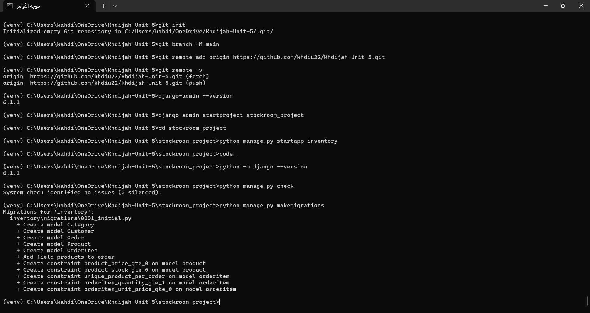

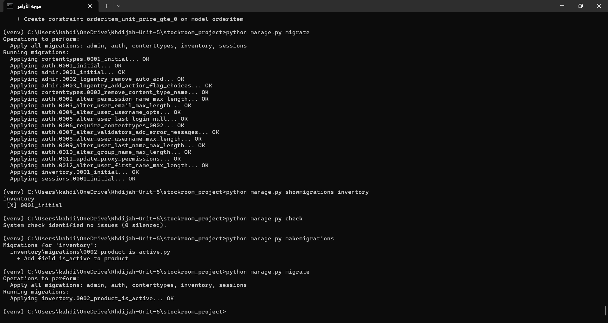

### Sample data

3 categories, 10 products, 3 customers, 5 orders, 10 order items. It includes active and inactive products, low-stock products and different prices. Two products (Gooseneck Kettle and Ceramic Espresso Cup) are inactive and are not in any order.

Commands (run inside `python manage.py shell`):

```python
from inventory.models import Category, Product, Customer, Order, OrderItem

beans = Category.objects.create(name="Coffee Beans")
tools = Category.objects.create(name="Brewing Tools")
mugs = Category.objects.create(name="Mugs and Cups")

p1 = Product.objects.create(name="Ethiopian Yirgacheffe 250g", sku="EY-250", price="62.50", stock=18, is_active=True, category=beans)
p2 = Product.objects.create(name="Colombian Supremo 250g", sku="CS-250", price="54.00", stock=4, is_active=True, category=beans)
p3 = Product.objects.create(name="Brazil Santos 1kg", sku="BS-1K", price="185.75", stock=9, is_active=True, category=beans)
p4 = Product.objects.create(name="Saudi Khawlani Beans 500g", sku="SK-500", price="98.30", stock=2, is_active=True, category=beans)
p5 = Product.objects.create(name="French Press 600ml", sku="FP-600", price="129.00", stock=25, is_active=True, category=tools)
p6 = Product.objects.create(name="V60 Dripper", sku="V6-DR", price="74.90", stock=5, is_active=True, category=tools)
p7 = Product.objects.create(name="Gooseneck Kettle", sku="GK-010", price="215.00", stock=0, is_active=False, category=tools)
p8 = Product.objects.create(name="Manual Burr Grinder", sku="BG-MAN", price="245.40", stock=1, is_active=True, category=tools)
p9 = Product.objects.create(name="Ceramic Espresso Cup", sku="EC-080", price="28.60", stock=60, is_active=False, category=mugs)
p10 = Product.objects.create(name="Travel Tumbler 450ml", sku="TT-450", price="67.25", stock=14, is_active=True, category=mugs)

c1 = Customer.objects.create(name="Reem Alotaibi", email="reem.alotaibi@stockroom.test")
c2 = Customer.objects.create(name="Faisal Alqahtani", email="faisal.q@stockroom.test")
c3 = Customer.objects.create(name="Dana Alshehri", email="dana.s@stockroom.test")

o1 = Order.objects.create(customer=c1, status="paid")
o2 = Order.objects.create(customer=c1, status="shipped")
o3 = Order.objects.create(customer=c2, status="pending")
o4 = Order.objects.create(customer=c2, status="paid")
o5 = Order.objects.create(customer=c3, status="shipped")

OrderItem.objects.create(order=o1, product=p1, quantity=3, unit_price="62.50")
OrderItem.objects.create(order=o1, product=p5, quantity=1, unit_price="129.00")
OrderItem.objects.create(order=o1, product=p10, quantity=2, unit_price="67.25")
OrderItem.objects.create(order=o2, product=p3, quantity=1, unit_price="185.75")
OrderItem.objects.create(order=o3, product=p2, quantity=2, unit_price="54.00")
OrderItem.objects.create(order=o3, product=p6, quantity=1, unit_price="74.90")
OrderItem.objects.create(order=o4, product=p8, quantity=1, unit_price="245.40")
OrderItem.objects.create(order=o4, product=p4, quantity=2, unit_price="98.30")
OrderItem.objects.create(order=o4, product=p10, quantity=1, unit_price="67.25")
OrderItem.objects.create(order=o5, product=p1, quantity=5, unit_price="62.50")
```

## 6. CRUD operations

**Create** - one record for every required model: see the `.create(...)` commands in section 5 (Category, Product, Customer, Order, OrderItem). Screenshots of running them:

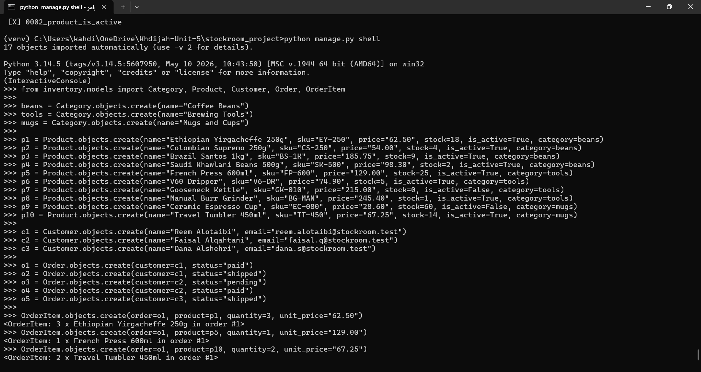

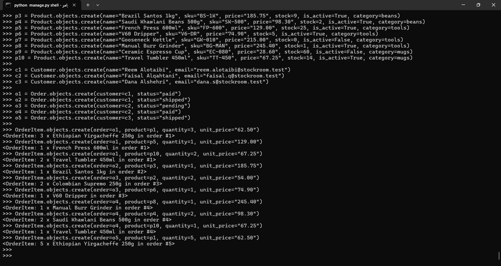

**Retrieve one record by primary key**

Question: what is product number 1?

```python
Product.objects.get(pk=1)
```

Result: `<Product: Ethiopian Yirgacheffe 250g (EY-250)>`

**Retrieve several records**

Question: which products are stored?

```python
Product.objects.all()
```

Result (10 products, ordered by name): Brazil Santos 1kg, Ceramic Espresso Cup, Colombian Supremo 250g, Ethiopian Yirgacheffe 250g, French Press 600ml, Gooseneck Kettle, Manual Burr Grinder, Saudi Khawlani Beans 500g, Travel Tumbler 450ml, V60 Dripper.

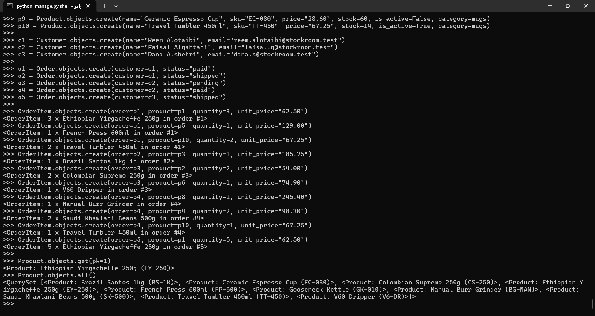

**Update a product price and stock**

Question: change the price and stock of the French Press (pk=5).

```python
p = Product.objects.get(pk=5)
p.price = "139.00"
p.stock = 30
p.save()
q = Product.objects.get(pk=5)
q.price, q.stock
```

Result: `(Decimal('139.00'), 30)`

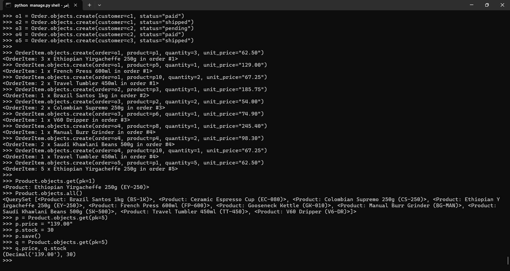

**Delete - result of the selected on_delete behaviour**

Question: can a product that appears in orders be deleted? (`OrderItem.product` uses PROTECT.)

```python
Product.objects.get(pk=1).delete()
Product.objects.count()
```

Result: `ProtectedError: Cannot delete some instances of model 'Product' because they are referenced through protected foreign keys: 'OrderItem.product'.` The count stays `10`, so nothing was deleted.

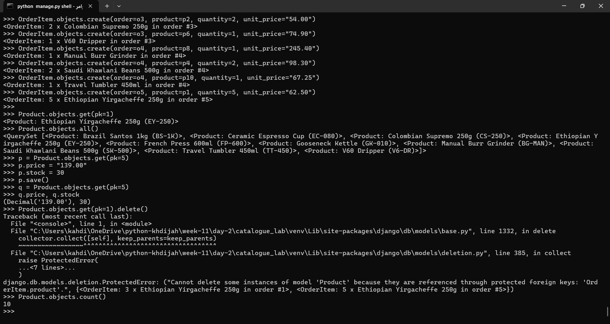

## 7. QuerySets and field lookups

All of these are in `inventory/queries.py` (each one is a function with its business question as a comment).

To run the commands below directly in the shell, import these first:

```python
from django.db.models import Avg, Count, F, Q, Sum
from inventory.models import Category, Product, Customer, Order, OrderItem
```

| # | Business question | ORM statement | Result |
|---|---|---|---|
| 1 | Which products are active? | `Product.objects.filter(is_active=True)` | 8 products: Brazil Santos, Colombian Supremo, Ethiopian Yirgacheffe, French Press, Manual Burr Grinder, Saudi Khawlani Beans, Travel Tumbler, V60 Dripper |
| 2 | Which products have stock <= 5? | `Product.objects.filter(stock__lte=5)` | Colombian Supremo, Gooseneck Kettle, Manual Burr Grinder, Saudi Khawlani Beans, V60 Dripper |
| 3 | Which products cost between 60 and 130? | `Product.objects.filter(price__gte=60, price__lte=130)` | Ethiopian Yirgacheffe, Saudi Khawlani Beans, Travel Tumbler, V60 Dripper |
| 4 | Which names contain "beans" (case-insensitive)? | `Product.objects.filter(name__icontains="BEANS")` | Saudi Khawlani Beans 500g |
| 5 | Which products remain after excluding the inactive ones? | `Product.objects.exclude(is_active=False)` | The same 8 active products |
| 6 | Products ordered by category name, then product name? | `Product.objects.order_by('category__name', 'name')` | French Press, Gooseneck Kettle, Manual Burr Grinder, V60 Dripper (Brewing Tools); Brazil Santos, Colombian Supremo, Ethiopian Yirgacheffe, Saudi Khawlani Beans (Coffee Beans); Ceramic Espresso Cup, Travel Tumbler (Mugs and Cups) |
| 7 | What are the five most recent orders? | `Order.objects.order_by('-created_at')[:5]` | Order #5 (Dana Alshehri), #4 and #3 (Faisal Alqahtani), #2 and #1 (Reem Alotaibi) |
| 8 | Which products have "grinder" in the name or "EY" in the SKU? (Q) | `Product.objects.filter(Q(name__icontains="grinder") \| Q(sku__icontains="EY"))` | Ethiopian Yirgacheffe, Manual Burr Grinder |
| 9 | Which order items have a quantity >= the product's current stock? (F) | `OrderItem.objects.filter(quantity__gte=F('product__stock'))` | 1 x Manual Burr Grinder (order #4), 2 x Saudi Khawlani Beans (order #4) |

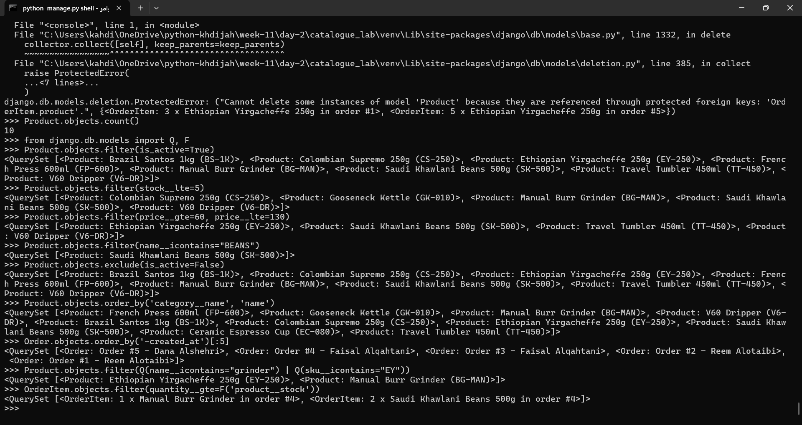

## 8. Relationship queries

(Same imports as section 7.)

| # | Business question | ORM statement | Result |
|---|---|---|---|
| 1 | What is the category of product 1? (forward) | `Product.objects.get(pk=1).category` | `<Category: Coffee Beans>` |
| 2 | Which products belong to Coffee Beans? (reverse) | `Category.objects.get(name="Coffee Beans").products.all()` | Brazil Santos, Colombian Supremo, Ethiopian Yirgacheffe, Saudi Khawlani Beans |
| 3 | Which orders belong to customer 1? | `Customer.objects.get(pk=1).orders.all()` | Order #2 and Order #1 (Reem Alotaibi) |
| 4 | Which items are in order 1? | `Order.objects.get(pk=1).items.all()` | 3 x Ethiopian Yirgacheffe, 1 x French Press, 2 x Travel Tumbler |
| 5 | Which product does order item 1 refer to? | `OrderItem.objects.get(pk=1).product` | `<Product: Ethiopian Yirgacheffe 250g (EY-250)>` |
| 6 | Which products are in order 1? | `Order.objects.get(pk=1).products.all()` | Ethiopian Yirgacheffe, French Press, Travel Tumbler |
| 7 | Which orders contain product 1? | `Product.objects.get(pk=1).orders.all()` | Order #5 (Dana Alshehri), Order #1 (Reem Alotaibi) |

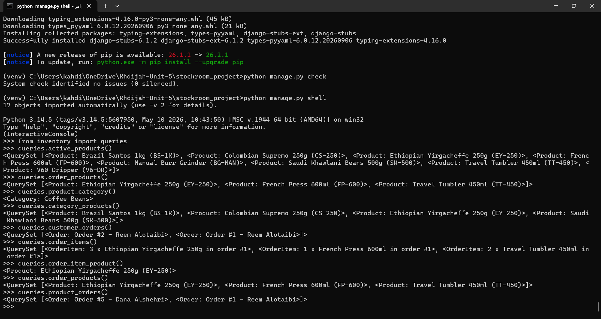

## 9. Annotation and aggregation

All calculations run in the database through the ORM (no Python loops). They are also functions in `inventory/queries.py`.

| # | Business question | ORM approach | Result |
|---|---|---|---|
| 1 | How many products are stored? | `Product.objects.aggregate(total_products=Count('id'))` | `{'total_products': 10}` |
| 2 | Average price of active products? | `Product.objects.filter(is_active=True).aggregate(avg_price=Avg('price'))` | `{'avg_price': Decimal('115.887500000000')}` |
| 3 | Total stock of active products? | `Product.objects.filter(is_active=True).aggregate(total_stock=Sum('stock'))` | `{'total_stock': 83}` |
| 4 | How many products in each category? | `Category.objects.annotate(product_count=Count('products')).values_list('name', 'product_count')` | Coffee Beans 4, Brewing Tools 4, Mugs and Cups 2 |
| 5 | How many order items in each order? | `Order.objects.annotate(item_count=Count('items')).values_list('id', 'item_count')` | (1, 3), (2, 1), (3, 2), (4, 3), (5, 1) |
| 6 | Total value of each order? | `Order.objects.annotate(total_value=Sum(F('items__quantity') * F('items__unit_price'))).values_list('id', 'total_value')` | (1, Decimal('451')), (2, Decimal('185.75')), (3, Decimal('182.900000000000')), (4, Decimal('509.25')), (5, Decimal('312.5')) |

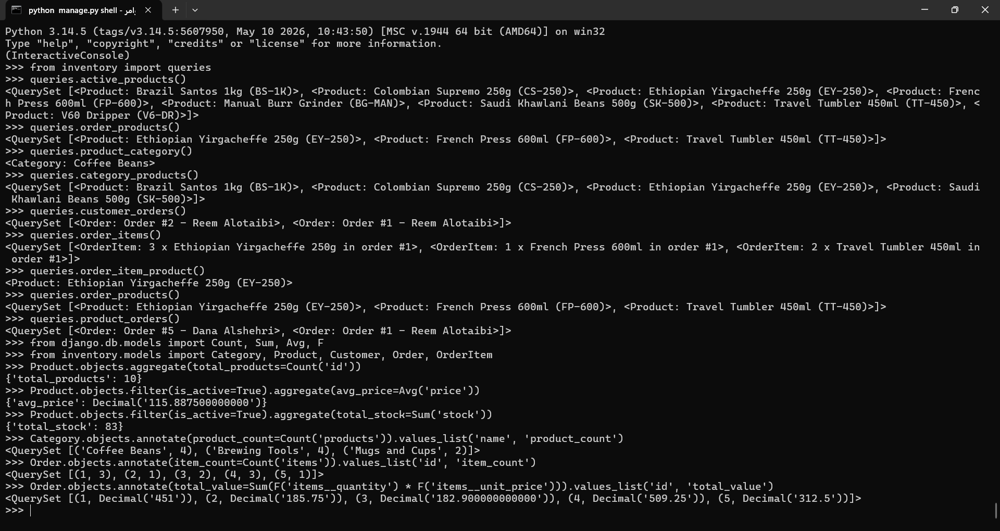

### Confirming the values against the sample data

- Products stored: 10 (p1 to p10 in section 5).
- Average active price: active prices are 62.50, 54.00, 185.75, 98.30, 139.00 (updated French Press), 74.90, 245.40, 67.25. Their sum is 927.10, and 927.10 / 8 = 115.8875.
- Total active stock: 18 + 4 + 9 + 2 + 30 (updated French Press) + 5 + 1 + 14 = 83.
- Products per category: Coffee Beans has 4, Brewing Tools has 4, Mugs and Cups has 2.
- Items per order: order 1 has 3, order 2 has 1, order 3 has 2, order 4 has 3, order 5 has 1 (10 items in total).
- Order values:
  - Order 1: 3 x 62.50 + 1 x 129.00 + 2 x 67.25 = 451.00
  - Order 2: 1 x 185.75 = 185.75
  - Order 3: 2 x 54.00 + 1 x 74.90 = 182.90
  - Order 4: 1 x 245.40 + 2 x 98.30 + 1 x 67.25 = 509.25
  - Order 5: 5 x 62.50 = 312.50

SQLite returns the decimals with extra trailing zeros (for example `115.887500000000`); the values are the same as the hand calculations above.

Order 1 still uses the stored `unit_price` of 129.00 for the French Press, even though the product price was later updated to 139.00.

### Optional challenge

This does not replace any of the six required calculations above.

Business question: which category has the highest number of active products?

```python
Category.objects.filter(products__is_active=True).annotate(active_count=Count('products')).order_by('-active_count').first()
```

Result: `<Category: Coffee Beans>`

To see the numbers behind it, the same query ending in `.values_list('name', 'active_count')` returns: Coffee Beans 4, Brewing Tools 3, Mugs and Cups 1. The Gooseneck Kettle and the Ceramic Espresso Cup are inactive, so they are not counted. It is also in `inventory/queries.py` as `category_with_most_active_products()`.

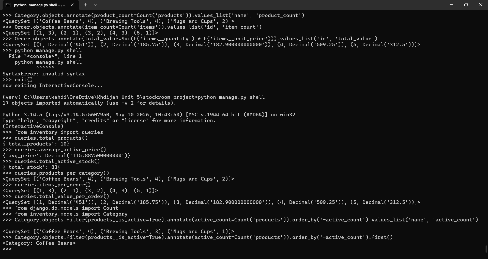

## 10. Required explanations

**Forward and reverse relationship traversal.** Forward traversal follows the ForeignKey from the model that holds it to the related model, for example `Product -> category` or `OrderItem -> product`. Reverse traversal goes the other way, from the model that is pointed to back to the models that point to it, using the `related_name`, for example `Category -> products`, `Customer -> orders` or `Order -> items`.

**Why OrderItem is a model and not only an automatic many-to-many table.** Each product in an order carries its own data: `quantity` and `unit_price`. An automatic many-to-many table only stores the two links. A model lets us add those fields and the constraints on them (quantity at least 1, unit_price not negative, the same product only once per order). It also keeps the price paid at the time of the order even if the product price changes later.

**Difference between `get()` and `filter()`.** `get()` returns exactly one object and raises an error if there are none (`DoesNotExist`) or more than one (`MultipleObjectsReturned`). `filter()` returns a QuerySet that can hold zero, one or many objects and does not raise an error when it is empty.

**When a QuerySet is evaluated and why it is lazy.** Creating or chaining a QuerySet (`filter`, `exclude`, `order_by`, slicing such as `[:5]`) does not touch the database. The query runs only when the results are needed, for example when looping over it, calling `list()` or `len()`, or when the shell prints it. QuerySets are lazy so that several steps can be combined into one SQL query and no database work is done for results that are never used.

**Why `aggregate()` returns one summary dictionary.** `aggregate()` collapses the whole QuerySet into a single summary row, so the result is one dictionary with the names we chose as keys (for example `{'total_products': 10}`). It does not return objects.

**Why `annotate()` adds a calculated value to each object or group.** `annotate()` calculates a value for each object (or group) and attaches it to that object, so we still get one object per row with an extra attribute (for example `product_count` on each Category).

**What defines the group in the category and order calculations.** In the category calculation, each Category is one group: the products linked to it are counted. In the order calculation, each Order is one group: its items are counted or summed (quantity multiplied by unit_price, then Sum). The group is defined by the object we annotate (grouped by its primary key).

## 11. Known limitations

- No user interface: the results are shown through the Django shell and `inventory/queries.py`.
- The relationship functions in `queries.py` use fixed primary keys (for example `pk=1`), so they assume the sample data was loaded in the order shown in section 5.
- Order status choices are limited to pending, paid and shipped.
- Only database constraints are used for validation; there is no friendly form validation yet.
- SQLite is used.

## 12. Future improvements

- Add friendly validation (for example in forms) on top of the database constraints.
- Customize the Django admin (list columns, filters, search).
- Move the sample data into a management command so it can be loaded with one command.
- Add automated tests for the constraints and queries.
- Add a simple interface to browse products and orders.
